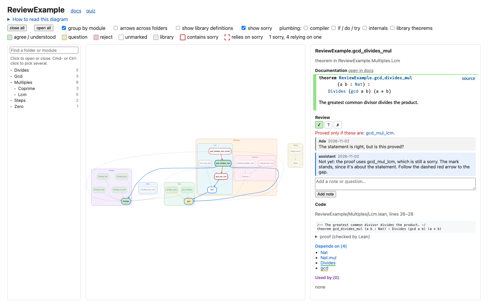

# lean-vouch

lean-vouch helps you check that Lean definitions and theorem statements mean what they should.
It shows your project as a dependency diagram, where you mark what you agree with, discuss questions
and disagreements, and see when something beneath a mark changes.



## Try it

You need Lean v4.30 or newer through elan, and Python 3.11 or newer. From the root of a Lake project:

```bash
pipx install lean-vouch
lean-vouch
```

With uv, install it with `uv tool install lean-vouch`.

Then open <http://127.0.0.1:8797/review/diagram>. Once the project itself builds, the first run takes
a minute or two, a few with Mathlib, and later runs take seconds. Your marks and notes are in
`.lean-vouch/marks/`, which git tracks unless you opt out; quiz answers stay local.

Doc pages are optional, and much slower to build: `lean-vouch --docs` adds the project's doc-gen4
pages, with the review controls under every declaration. Building them the first time takes about 7
minutes, or about 35 with Mathlib. The project keeps them from then on.

> [!WARNING]
> Only run this on code you trust. Building a Lean project runs its macros and build scripts, and the
> graph step runs its initializers, so reviewing a stranger's project runs their code on your machine.

## What you get

- **Marks and notes** on every declaration, each person's in their own file.
- **Change tracking:** flags when something you marked, or anything below it, changes, and shows the
  way down to what changed.
- **A dependency diagram** colored by your marks, which opens as folders on a large project. Each
  declaration shows its docstring, its statement as Lean understood it, and its code.
- **`sorry` tracing:** everything that relies on one, even through proofs.
- **Quiz mode:** read a statement with its name hidden, say what it means, then compare.
- **Working together:** others' marks and questions beside yours, from people or assistants, live on
  open pages.
- **Challenges for `lake comparator`:** the statements you've chosen and reviewed, written out so
  comparator can hold the project to them.
- **Doc pages, if you want them:** the same review controls under each declaration on its doc-gen4
  page.

lean-vouch is a review aid, not a checker: for soundness, use `lake check` or `lake comparator`, in
Lean v4.35 or newer. lean-vouch is still early: it handles projects as large as Mathlib, but has
mostly been used to review small ones.

## More

[Features](https://github.com/jjeffrey/lean-vouch/blob/main/docs/features.md) · [Walkthrough](https://github.com/jjeffrey/lean-vouch/blob/main/docs/usage.md) · [Setup](https://github.com/jjeffrey/lean-vouch/blob/main/docs/setup.md) · [Quiz mode](https://github.com/jjeffrey/lean-vouch/blob/main/docs/quiz.md) · [Challenges](https://github.com/jjeffrey/lean-vouch/blob/main/docs/challenge.md) ·
[How it works](https://github.com/jjeffrey/lean-vouch/blob/main/docs/internals.md) · [Developing](https://github.com/jjeffrey/lean-vouch/blob/main/docs/development.md) ·
[Changelog](https://github.com/jjeffrey/lean-vouch/blob/main/CHANGELOG.md)

Apache License 2.0. Copyright 2026 Jonathan Jeffrey.
