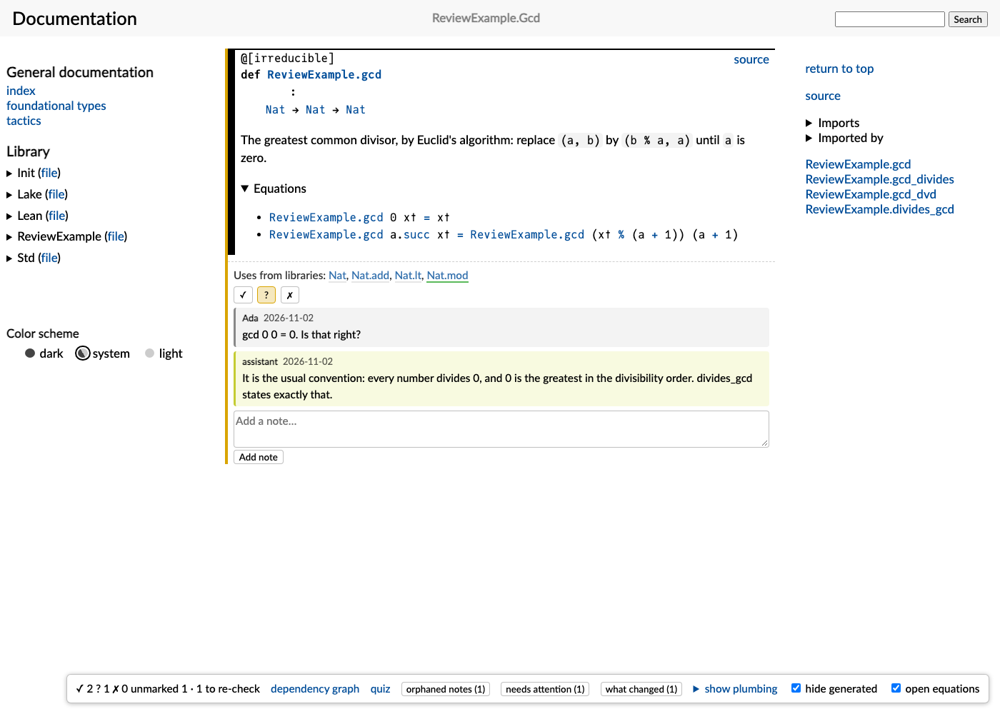
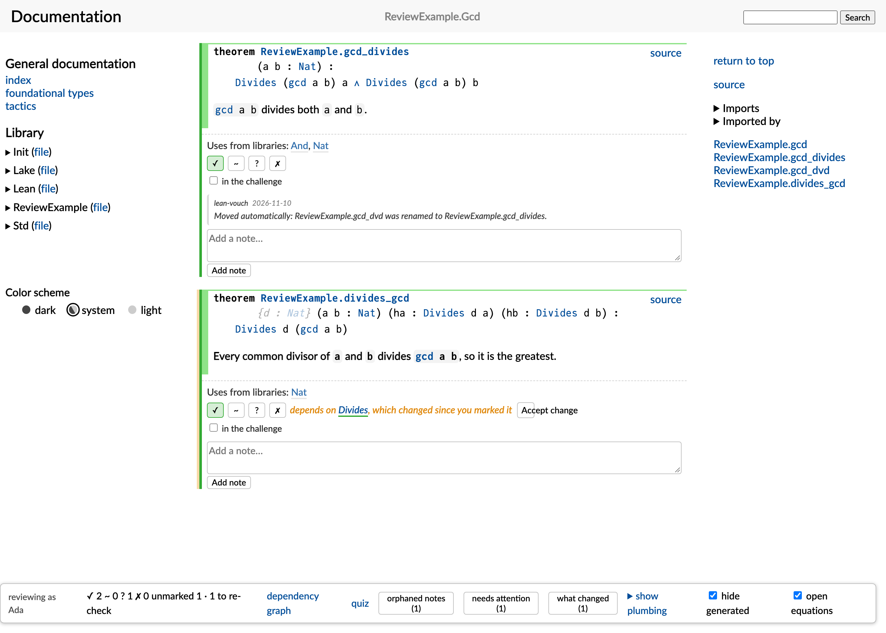
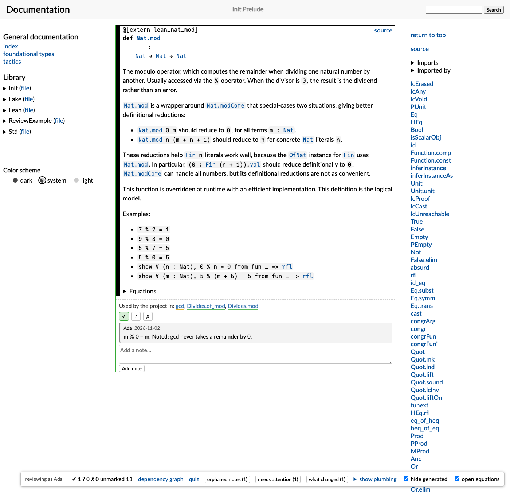
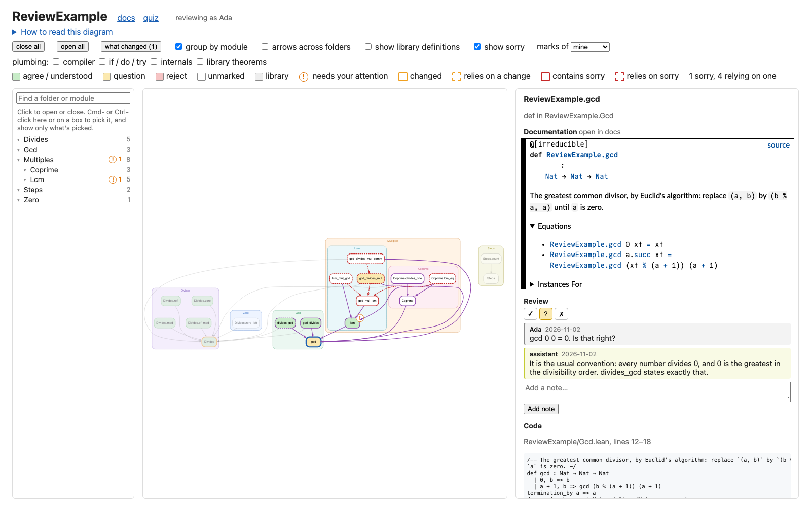
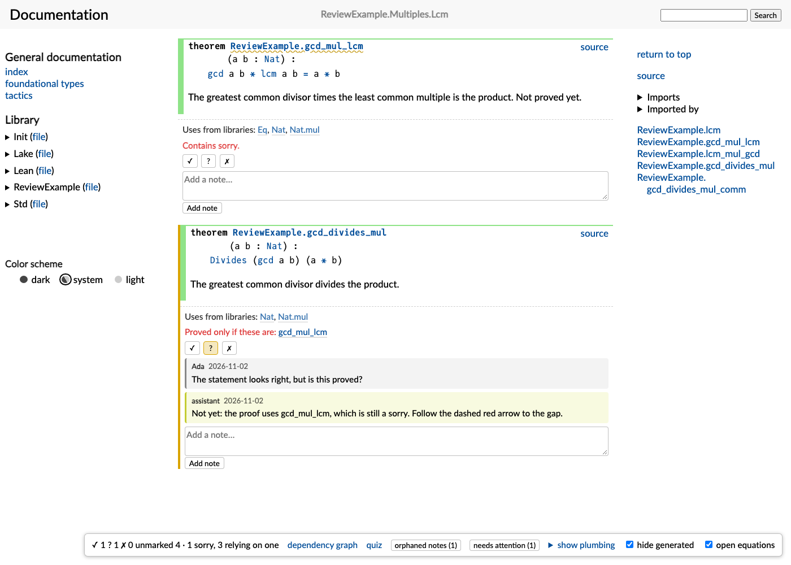
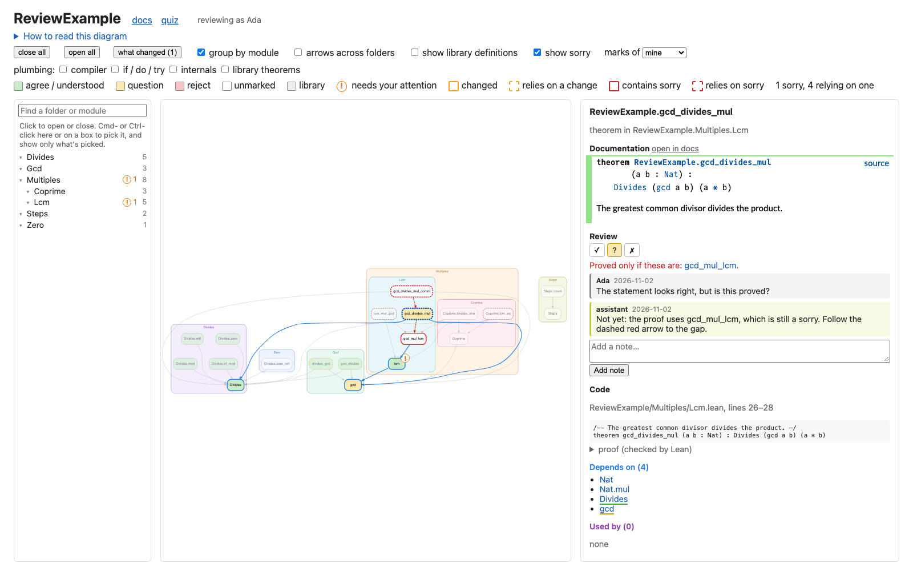
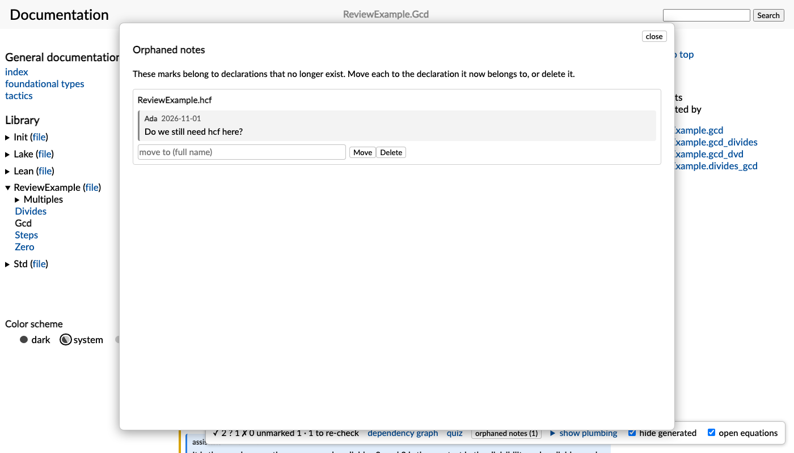
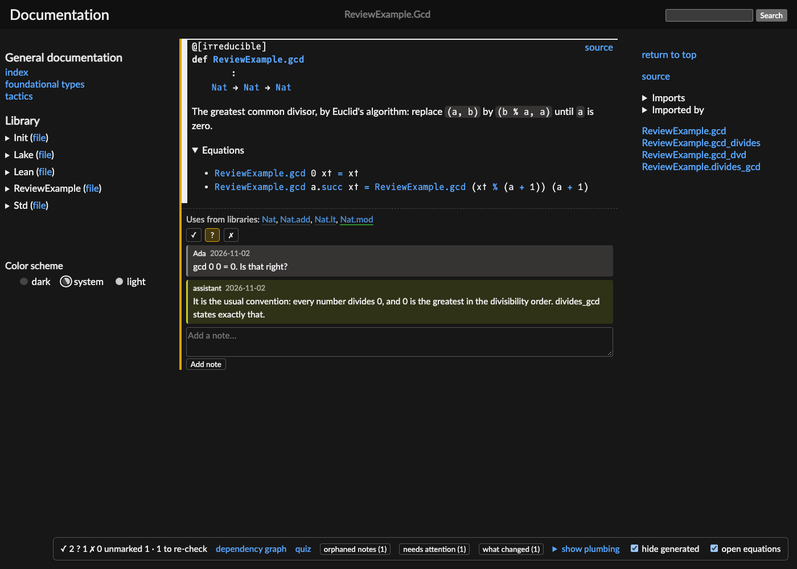

# Features

Under every declaration:

- **A mark:** ✓ agree, ? question, ✗ reject how it's defined. Click it again to clear it.
- **A note thread,** for questions and answers, from everyone reviewing.
- **Change tracking:** the mark is flagged when the declaration has changed since it was made, or
  when anything it depends on has ("depends on `Divides`, which changed since you marked it"), however
  far below. In the diagram a solid orange border is what changed and a dashed one what relies on it, and
  selecting one lights the way down to the change. "What changed" lists every change, lowest first, with
  how many marks rely on it. Each mark stays flagged until you've looked at it, and **Accept change**
  keeps it for the current version. That covers one mark: accepting a change below doesn't accept
  what's built on it.
  For a theorem only its statement counts, since Lean checks the proof; for a definition, its
  statement and body. A change only to how an argument is passed, such as `(n : Nat)` to
  `{n : Nat}`, isn't flagged: it changes how the declaration is called, not what it says.
- **The library definitions it uses** ("Uses from libraries: `Nat`, `Nat.mod`").
- **Its equations, open.** doc-gen4 folds a definition's equations; for review they are what you
  check, so project declarations show them open, on the pages and in the diagram's sidebar.
  "open equations" at the bottom of the page switches this off (remembered per browser). Library
  pages keep doc-gen4's folding.

Across the project:

- **Library definitions can be marked too,** on their own doc pages, meaning "I understand this",
  so you record what `%` on `Nat` means to you once, for every use.
- **Refactors:** renames recorded as deprecated aliases (`@[deprecated] alias Old := New`) move
  marks automatically. Marks whose declaration no longer exists are listed as orphaned notes, to
  move or delete; none disappear silently.
- **A dependency diagram,** on its own page: a Hasse diagram of the project's declarations (and
  optionally the library definitions they use), colored by your marks. Clicking a node highlights
  what it depends on and what depends on it, and opens a sidebar with its mark and notes (editable
  there), its code (a theorem's proof collapsed), and its direct dependencies and dependents.
- **What a `sorry` reaches,** on by default if the project has one. A declaration that contains
  `sorry` gets a red border, and whatever relies on it a dashed one, even if only through a proof,
  with dashed red arrows leading to it step by step. Folders count both, and the pages name the `sorry`s each declaration depends on. A mark is about the
  statement, so it stands: a theorem can be agreed and still unproved. `native_decide` and any other
  axiom beyond Lean's standard three are listed too. Filling in a proof changes no fingerprint and no
  mark.
- **Folders,** in the same diagram. A project of more than 60 declarations opens as boxes, one per
  folder or module, each saying how much of it you have marked; click one to open it, and click an
  open box's label to close it. A thicker arrow between boxes stands for more dependencies, and by
  default arrows are drawn only between neighbors in one folder. All of Mathlib opens this way: 32
  boxes, with a module's declarations fetched when you open it.
- **The list of folders and modules,** beside the diagram. Click one to open or close it, search by
  name, and Cmd- or Ctrl-click one here or its box in the diagram to pick it, opening it, however
  distant: the diagram then shows only what's picked and the arrows between them.
- **Shift-click** a declaration, a box or a row in the list to color everything it depends on and
  everything that uses it, all the way down and up, and list how much of each is in each folder.

## Screenshots

From the [example](development.md#example), with its example marks.

**A declaration under review:** its mark, the library definitions it uses, and a note thread.

**Change tracking:** a mark moved automatically by a rename (`gcd_dvd` → `gcd_divides`), and a
mark flagged because something below it changed.

**A library definition marked as understood,** with the project declarations that use it.

**The dependency diagram:** `gcd` selected, with what depends on it highlighted, modules boxed,
and the sidebar showing its documentation, review and code.

**A `sorry` and what relies on it:** `gcd_mul_lcm` isn't proved, so `gcd_divides_mul` holds only if it
is, which a reviewer has asked about. Its statement never mentions `gcd_mul_lcm`; the proof does.

In the diagram, solid red borders mark a `sorry`, dashed ones what relies on it, and dashed red arrows
how. Shift-click one to color all it reaches.

**Orphaned notes,** left behind when a declaration is removed.

**Dark theme:** the controls follow doc-gen4's light, dark and system themes.

