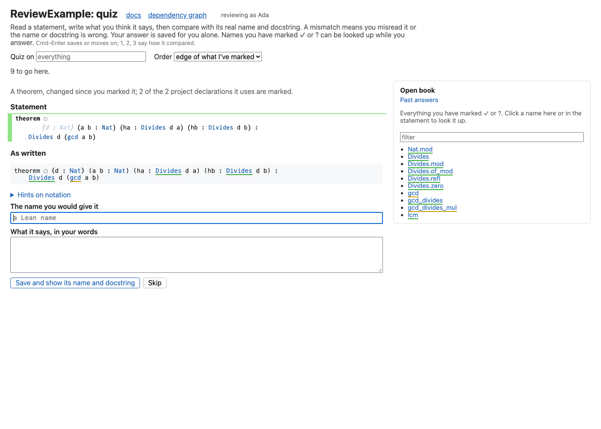

# Quiz mode

A mark records what you think you understand; quiz mode checks it. Open "quiz" from the bar at the
bottom of any page (or `/review/quiz?name=Full.Name` for a particular declaration).

- **You choose what it asks about:** everything, a folder or a module, in the box at the top or with
  "Quiz this" on a box in the diagram. By default it picks declarations at the edge of what you have
  marked: unmarked, with at least half of what they use marked, after any changed since you marked
  them. Or choose random order, from everything unmarked or changed. Either way ties are shuffled.
- **You see the statement only:** its header as doc-gen4 renders it and its code as written (a
  theorem's statement without the proof), with the name hidden, even in recursive calls, and comments,
  including the docstring, removed. You write what it says and the name you would give it; the
  namespace is filled in, and an instance's name isn't asked for.
- **Then its real name and docstring are shown next to yours.** Your answer is saved first, in your
  own quiz file, which git ignores by default, and shows under the declaration for you alone. You say
  whether your reading matched, which is recorded apart from your mark: reading a statement right isn't agreeing with it. A mismatch is
  something to discuss: either you misread it, or the name or docstring is wrong. Buttons mark it ✓ or
  ?, or ? with a note proposing your name as a rename. With no docstring, your answer can be saved as a
  suggested one.
- **Progress:** the counts for this session are at the top, and "Past answers" lists every answer,
  misses first.
- **Keyboard:** Cmd-Enter saves your answer or moves on, and 1, 2, 3 say how it compared.
- **Open book:** while answering, every declaration you have marked ✓ or ? can be looked up
  (statement and docstring), from the list beside it or by clicking a name in the statement.
  Anything else asks first, with "Show anyway".
- **Hints explain notation, never meaning:** which parts are arguments and which the conclusion,
  what `{n : Nat}` (implicit), `[…]` and `⦃…⦄` arguments are, that `.zero` is shorthand for
  `Nat.zero` because a `Nat` is expected there, that `l.length` is `List.length` with `l`
  filled in, and symbols such as `→`, `∀` and `⟨…⟩`. They never paraphrase the claim: an explanation of the
  meaning would make the comparison worthless.
