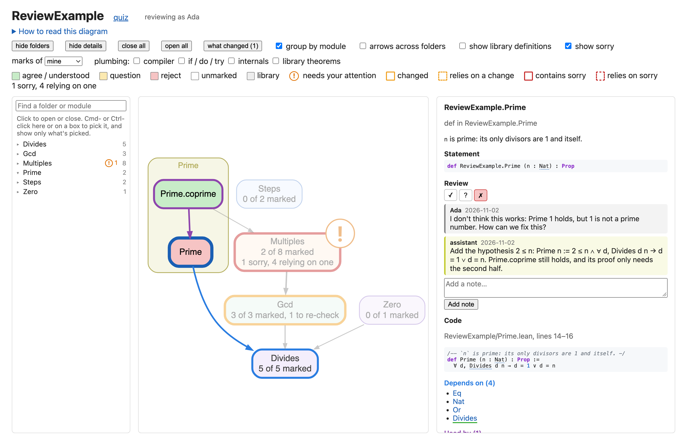
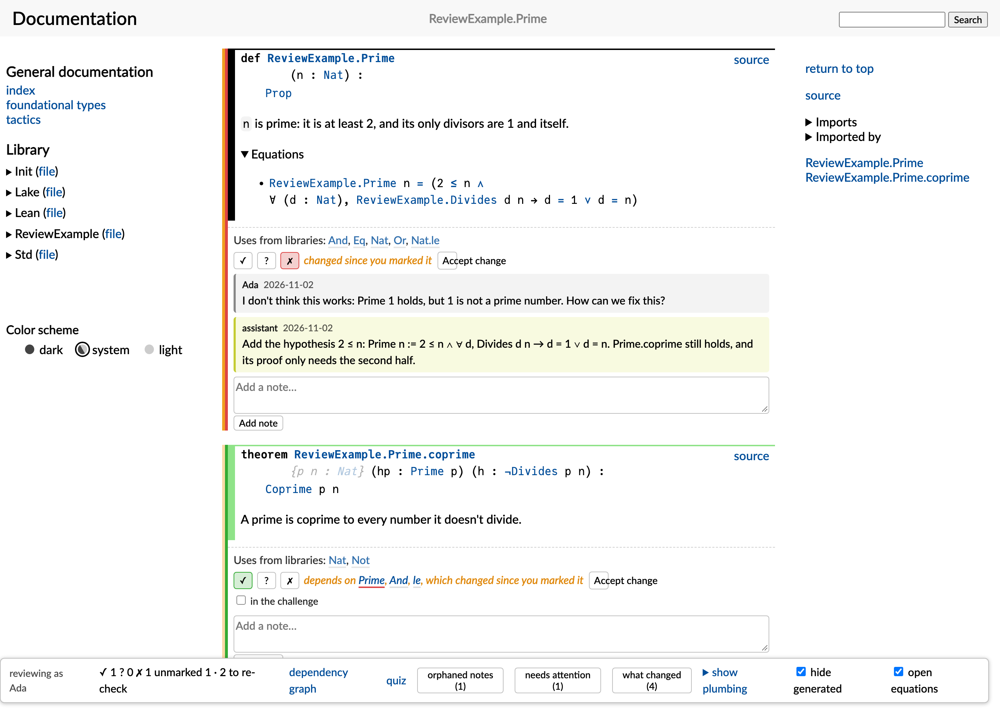

# Walkthrough: a definition that doesn't say what it should

Lean checks that a proof proves its statement. It can't check that the statement means what you
meant. This walkthrough follows one mismatch from noticing it to fixing it, with what lean-vouch
does at each step. For installing and running it, see [Setup and options](setup.md).

The [example](development.md#example) defines primes in `ReviewExample.Prime`:

```lean
/-- `n` is prime: its only divisors are 1 and itself. -/
def Prime (n : Nat) : Prop :=
  ∀ d, Divides d n → d = 1 ∨ d = n

/-- A prime is coprime to every number it doesn't divide. -/
theorem Prime.coprime {p n : Nat} (hp : Prime p) (h : ¬ Divides p n) : Coprime p n
```

The docstring reads like the definition, and `Prime.coprime` is proved. But the only divisor of 1 is
1, so `Prime 1` holds, and every theorem about primes quietly includes 1. The example leaves this
unfixed, with marks that show it partway through review, so you can follow along.

## 1. Noticing it

You might notice it reading `Prime` in the diagram's sidebar, which shows its docstring next to its
statement, or on its docs page, if you build them. [Quiz mode](quiz.md) helps you notice: it shows
the statement with its name hidden, you write what you think it says, and then you compare. Writing
"n has no divisors but 1 and n" and then asking "so is 1 prime?" is often where this turns up.

An assistant reviewing the project can raise it too, by leaving a `?` with a note on `Prime`. When
someone else asks a question like that, you see a `!` on the declaration, meaning someone is
waiting on you.

## 2. Recording it

Click ✗ on `Prime` and add a note saying why. The note can also ask how to fix it. If you're not
sure it's wrong, use `?` instead. A `?` with a note asks the others, people or assistants, and
shows them a `!` until they mark or reply.

In the example, Ada rejected `Prime`, and an assistant answered with a fix:



The marks and notes go in each person's file in `.lean-vouch/marks/`, so an assistant asked to fix
things can read why you rejected something.

## 3. Seeing what it affects

Open the diagram and Shift-click `Prime`. Everything that depends on it and everything it depends
on are colored, with how much of each is in each folder. Each theorem in that upper set is about
this definition of `Prime`, so each may say something other than what was meant, though all of them
still compile. In the example, Ada agreed with `Prime.coprime` before she noticed: it reads right,
but it's about this definition. Clicking `Prime` instead, as in the picture above, shows only what it
directly depends on and what directly uses it.

## 4. Fixing it

Make the change, or ask the assistant to. Here it's the hypothesis the assistant suggested:

```lean
/-- `n` is prime: it is at least 2, and its only divisors are 1 and itself. -/
def Prime (n : Nat) : Prop :=
  2 ≤ n ∧ ∀ d, Divides d n → d = 1 ∨ d = n
```

Lean then shows which proofs needed 1 to count, and those get fixed too. Open pages then say the code
has changed since the last build. Click **Rebuild** there, or run `lean-vouch` again in another
terminal. Pages show how far it has got, and offer to reload when it's done.

## 5. Re-checking what changed

After the rebuild, lean-vouch flags every mark the change could affect:

- Your ✗ on `Prime` says "changed since you marked it".
- Every mark you made on something that uses `Prime`, however far up, says it "depends on
  `Prime`, which changed since you marked it".
- **what changed** lists each change, with how many of your marks rely on it. In the diagram, `Prime`
  has a solid orange border, and what relies on it a dashed one. Selecting a flagged declaration
  lights the way down to the change.

With the fix, in a copy of the example, on its doc page:



`Prime.coprime` now also depends on `And` and `≤` (`Nat.le`), which are new, and so are listed with
`Prime`.

For a theorem, only its statement counts, since Lean checks the proof. So a theorem whose proof
alone changed isn't flagged.

Start with `Prime`. Read the new definition and click ✓. The note thread stays, as a record of why
it changed. Then go up through what was flagged. For each, read the statement again with the new
definition in mind. If it still says what it should, click **Accept change**, which keeps that one
mark for the current version and accepts nothing above it. If it doesn't, mark it ✗ or `?` and
repeat.

## 6. Keeping the record

Commit your marks file with the fix. It records what you checked, and against which version, so
anyone who pulls it sees your marks beside theirs: see [working with others](setup.md#working-with-others).
